

  

  <a href="https://cristian-os-portafolio.vercel.app/">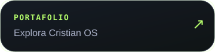</a>
  <a href="https://github.com/cristian7712?tab=repositories">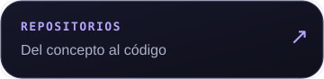</a>
  <a href="mailto:cristian.diaz8918@gmail.com">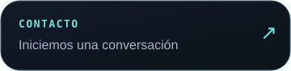</a>

  <a href="#sobre-mí">Sobre mí</a> &nbsp; / &nbsp;
  <a href="#github-en-datos">GitHub en datos</a> &nbsp; / &nbsp;
  <a href="#tecnologías">Tecnologías</a> &nbsp; / &nbsp;
  <a href="#en-el-radar">En el radar</a> &nbsp; / &nbsp;
  <a href="#conectemos">Conectemos</a>

## Sobre mí

Soy **Cristian David Díaz Tovar**, desarrollador de software y docente de programación en **Pasto, Colombia**. Transformo ideas en soluciones prácticas y acompaño a otras personas a comprender, construir y crecer con la tecnología.

Mi enfoque combina **código mantenible, fundamentos sólidos y aprendizaje a través de proyectos**. Disfruto conectar la lógica del backend con experiencias claras en el frontend, y convertir conceptos complejos en explicaciones que se puedan llevar a la práctica.

  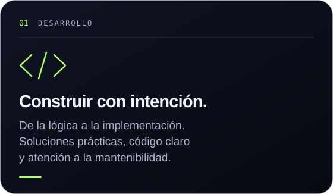
  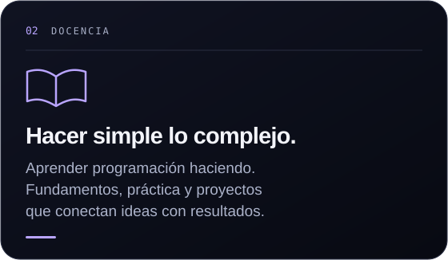

> **Construir para resolver. Enseñar para multiplicar lo aprendido.**

## Portafolio

<a href="https://cristian-os-portafolio.vercel.app/">
  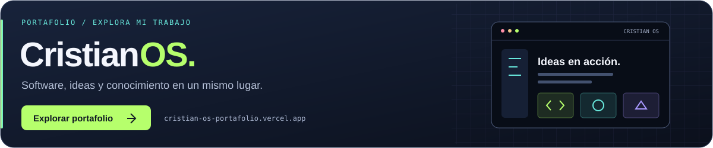
</a>

**[Abrir Cristian OS →](https://cristian-os-portafolio.vercel.app/)** &nbsp; · &nbsp; [Explorar código en GitHub ↗](https://github.com/cristian7712?tab=repositories)

## GitHub en datos

Una mirada a lo que construyo, las tecnologías que exploro y mi actividad a lo largo del tiempo.

<a href="https://github.com/cristian7712?tab=repositories">
  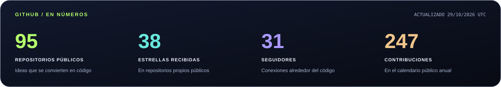
</a>

<a href="https://github.com/cristian7712?tab=overview">
  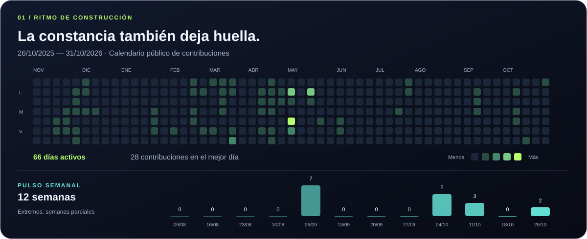
</a>

<a href="https://github.com/cristian7712?tab=repositories">
  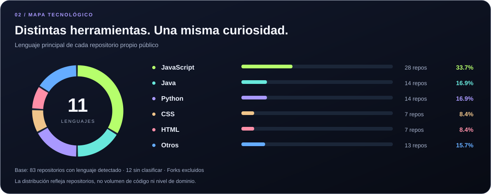
</a>

<strong>Cómo leer estas gráficas</strong>

- **Repositorios:** todos mis repositorios públicos. Las estrellas corresponden a repositorios propios, excluyendo forks.
- **Actividad:** contribuciones que GitHub muestra en mi calendario público del último año. Cada celda representa un día; las barras agrupan las últimas doce semanas y los extremos pueden ser semanas parciales.
- **Lenguajes:** cada repositorio propio público cuenta una vez según su lenguaje principal detectado por GitHub. Los porcentajes se calculan sobre los repositorios con lenguaje detectado; representan distribución de proyectos, no dominio técnico ni líneas de código.
- **Actualización:** diaria mediante GitHub Actions; la fecha de la última generación aparece en el panel. [Consultar los datos en GitHub ↗](https://github.com/cristian7712)

## Tecnologías

  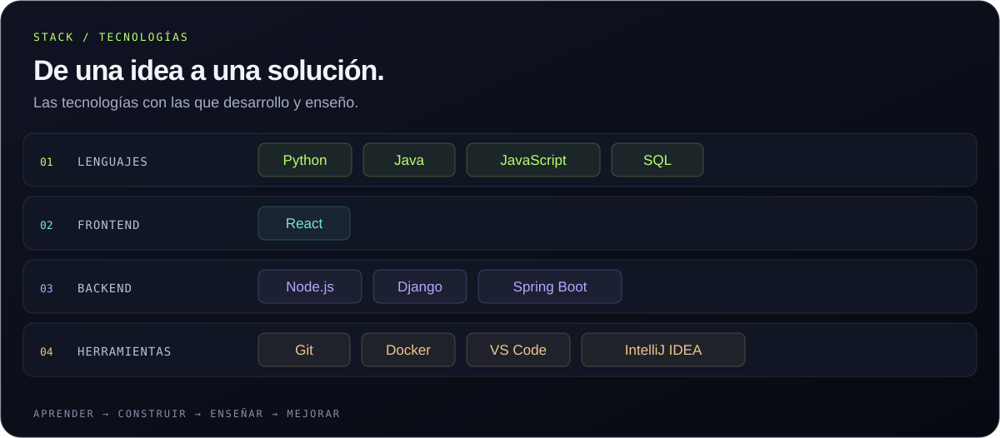

<strong>Consultar el stack en texto</strong>

| Área | Tecnologías |
| :--- | :--- |
| Lenguajes | Python · Java · JavaScript · SQL |
| Frontend | React |
| Backend | Node.js · Django · Spring Boot |
| Herramientas | Git · Docker · Visual Studio Code · IntelliJ IDEA |

## En el radar

Aprender, aplicar y compartir es parte de mi proceso.

| Enfoque | Lo que busco |
| :--- | :--- |
| **Arquitectura de software** | Diseñar soluciones claras y fortalecer las buenas prácticas. |
| **Educación interactiva** | Convertir conceptos en experiencias prácticas de aprendizaje. |
| **Automatización** | Simplificar tareas y mejorar los flujos de trabajo. |

<strong>Fuera del editor</strong> · Idiomas y otras curiosidades

La educación, los idiomas y el crecimiento continuo también forman parte de lo que me mueve.

**ES** Español nativo &nbsp; · &nbsp; **EN** Inglés intermedio &nbsp; · &nbsp; **IT** Italiano principiante

## Conectemos

<a href="mailto:cristian.diaz8918@gmail.com">
  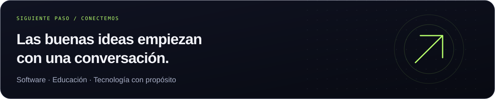
</a>

  <a href="mailto:cristian.diaz8918@gmail.com"><strong>cristian.diaz8918@gmail.com</strong></a>
  &nbsp; · &nbsp;
  <a href="https://cristian-os-portafolio.vercel.app/">Cristian OS ↗</a>

Desde Pasto, Colombia · Software con propósito. Conocimiento que se comparte.

